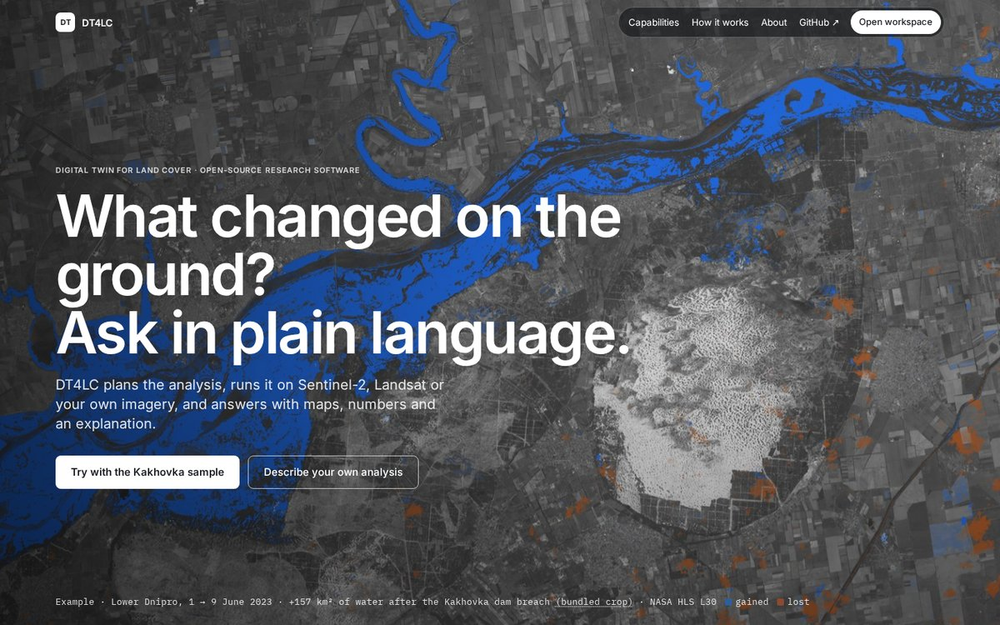
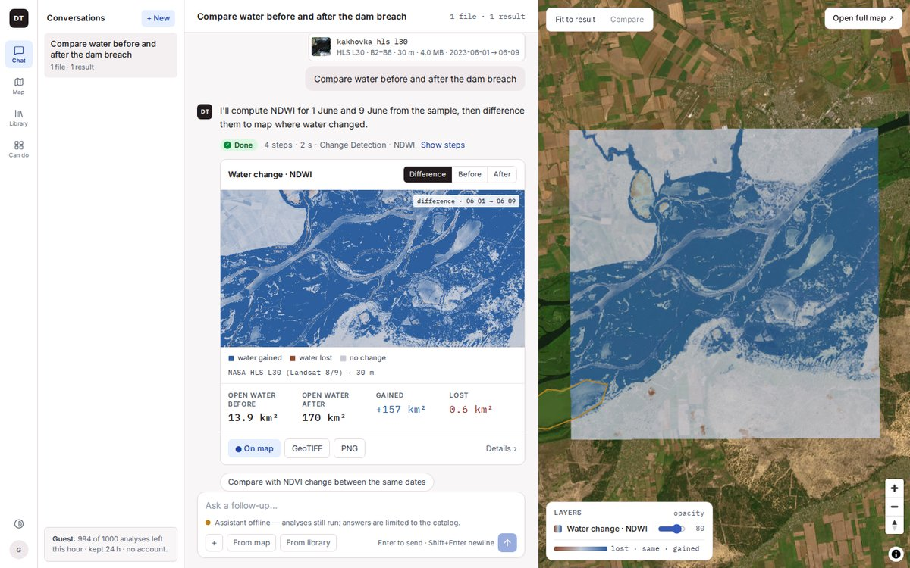
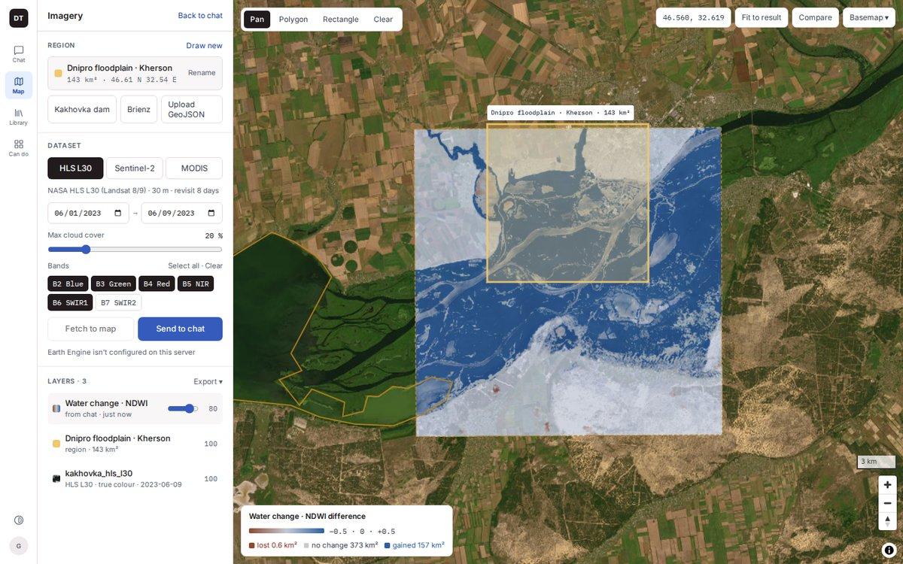
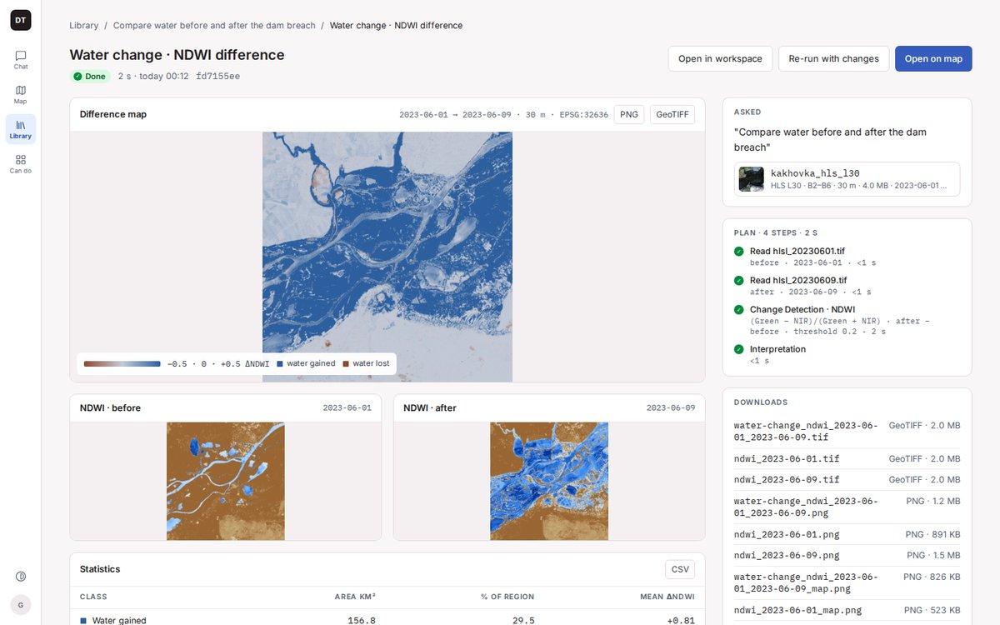
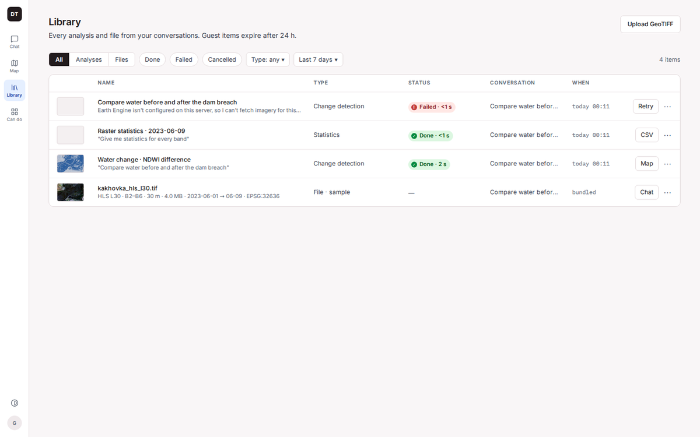
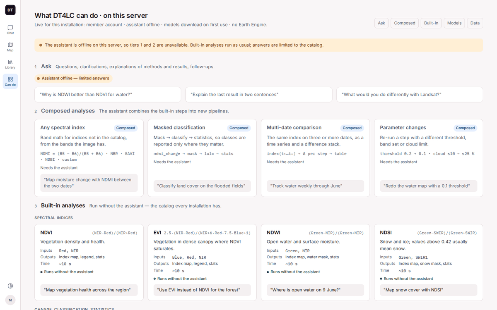
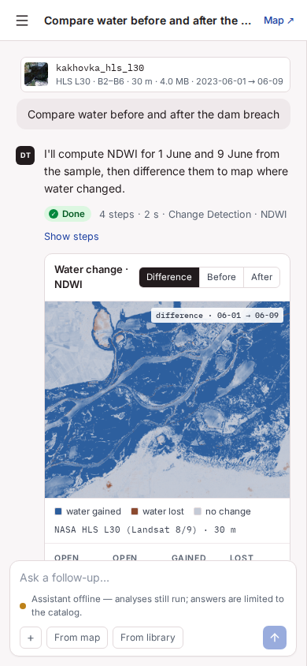

# DT4LC - Digital Twin for Land Cover

A cognitive digital twin framework for land cover change detection and vegetation analysis using satellite imagery, machine learning, and LLM-powered orchestration.

It is aimed at remote sensing researchers, environmental scientists and disaster response teams who need to perform land cover analysis without building custom processing pipelines.

## Features

- **Ask in plain language** - In the Workspace, one assistant message narrates one analysis: what it will do, the plan steps as they run, and a result card with the map, its legend, km² statistics and follow-up suggestions. Questions get markdown answers and never start a job.
- **Built-in analyses** - NDVI, EVI, NDWI and NDSI; change detection between two dates; land-cover and snow classification; raster statistics; field boundaries with Delineate-Anything; Prithvi reconstruction. They run without an LLM.
- **Composed analyses** - Band math for indices that are not in the catalog (NDMI, NBR, SAVI, NDBI or your own formula), offered as a plan that runs only after you confirm it.
- **Map mode** - Draw or pick a region and send it to the chat, show results as map layers with their legends and class areas, and compare two layers with a swipe. The bundled sample is shown in true colour with its footprint. Fetching imagery by region needs an Earth Engine key.
- **Library and Result detail** - Every analysis and file in one filtered list. Each result has a page with its maps, the class statistics (with CSV), the plan steps and their parameters, the interpretation, and downloads with readable names such as `water-change_ndwi_2023-06-01_2023-06-09.tif`.
- **Capabilities** - A live page of what this server can do for you, in six tiers, computed from its state: the assistant, the installed models, Earth Engine and your role.
- **Guests, members and operators** - No login wall. Guests get a few analyses per hour, kept for 24 h. Members sign in with GitHub, if their email is on an allowlist, and have no limit. Operators also get Settings: LLM providers and models, model downloads, allowlists and guest limits, applied without a restart.
- **Multi-provider LLM with deterministic fallback** - Gemini, Groq, OpenAI, Anthropic, Mistral, and local Ollama or Apertus, tried in order; every stage has a deterministic fallback, so built-in analyses run with no provider at all.
- **Public demo deployment** - A Docker Compose override with pre-installed models, per-IP rate limits and the client address forwarded through a TLS proxy ([docs/DEPLOY_DEMO.md](docs/DEPLOY_DEMO.md)).
- **Phone, tablet and dark theme** - Layouts for phones and tablets (tested at 390 and 834 px wide) and a dark theme on every screen; the seven main screens pass axe with no serious or critical violation in either theme.

## Screenshots

From the browser end-to-end tests (`cognitive_ui/tests/e2e/`), on the bundled Kakhovka sample, with no LLM provider and no Earth Engine key.



*The landing page. The image is the full scene; the caption quotes the bundled crop's +157 km² of water.*



*The Workspace after "Compare water before and after the dam breach": one message, the result card and its follow-up, and the result on the docked map.*



*Map mode: a drawn region ready for Send to chat, the result and sample layers, and the legend with the class areas.*



*Result detail: maps, plan steps with their parameters, statistics and downloads.*



*The Library: analyses (done and failed) and the sample file in one list.*



*Capabilities on a local server with the assistant offline.*



*The Workspace on a phone.*

## Architecture

```text
┌────────────────────────────────────────────────────────────────────┐
│ Frontend (React): Landing, Workspace, Map, Library,                │
│ Result detail, Capabilities, Settings                              │
│ http://localhost (nginx, Docker) · http://localhost:3000 (Vite)    │
└─────────┬──────────────────────────────────────────────────────────┘
          │ /v1/* with the session cookie
          ▼
┌────────────────────────────────────────────────────────────────────┐
│ Backend (FastAPI) · http://localhost:8000                          │
│ ┌────────────────────────────────────────────────────────────────┐ │
│ │ Sessions: a signed dt4lc_session cookie on every request       │ │
│ │  • role: guest; member or operator after GitHub sign-in        │ │
│ │  • an owner on each job and upload (operators see them all)    │ │
│ │  • guest quota: 5 analyses per hour (GUEST_ANALYSES_PER_HOUR)  │ │
│ └────────────────────────────────────────────────────────────────┘ │
│ POST /v1/chat ──► markdown reply (no job), or an analysis job      │
│ POST /v1/jobs ──► job queue (SQLite) ──► COE plan ──► DTI run      │
│ GET /v1/jobs/{id}/events ──► the job's event log as SSE            │
│ GET /v1/capabilities ──► six tiers for this caller and server      │
│ ┌────────────────────────────────────────────────────────────────┐ │
│ │ Context Orchestration Engine (COE)                             │ │
│ │  • Intent Classifier (pipeline vs conversation)                │ │
│ │  • Context Agent (what the request needs)                      │ │
│ │  • Planner (template; LLM planner when confidence < 0.7)       │ │
│ │  • Plan Validator (resources, inputs, entrypoints)             │ │
│ └────────────────────────────────────────────────────────────────┘ │
│ ┌────────────────────────────────────────────────────────────────┐ │
│ │ Digital Twin Instance (DTI)                                    │ │
│ │  • Pipeline Executor                                           │ │
│ │  • Algorithms (indices, band math, change, classes, stats)     │ │
│ │  • Models (Prithvi, Delineate-Anything)                        │ │
│ └────────────────────────────────────────────────────────────────┘ │
└─────────┬──────────────────────────────────────────────────────────┘
          │ LLM calls: intent, context, plan, interpretation, replies
          ▼
┌────────────────────────────────────────────────────────────────────┐
│ LLM router (LLM_PROVIDER_ORDER, default strategy fallback)         │
│ Gemini · Groq · OpenAI · Anthropic · Mistral · Ollama · Apertus    │
│ unavailable or error ──► the next provider                         │
│ no provider answers ──► deterministic fallbacks:                   │
│   intent → pipeline request, context → registry triggers,          │
│   plan → template planner, chat reply → the catalog                │
└────────────────────────────────────────────────────────────────────┘
```

The components, sessions, event stream and fallbacks are described in [docs/ARCHITECTURE.md](docs/ARCHITECTURE.md).

## Quick Start

### Docker (Recommended)

```bash
# 1. Clone and navigate to project
git clone https://github.com/IPT-MMDA/DT4LC-project.git
cd DT4LC-project

# 2. Set up environment
cp .env.example .env
# Optional: Add GEMINI_API_KEY or GROQ_API_KEY for faster LLM responses

# 3. Start all services, including the local Ollama LLM (no API key needed)
docker compose --profile ollama up -d

# 4. Wait for the one-time llama3.2 pull and for the services to become healthy
docker compose logs ollama-pull    # ends with "Model pull complete!"
docker compose ps

# 5. Open application
open http://localhost
```

The UI is at <http://localhost>, and nginx also serves the API reference there: Swagger UI at <http://localhost/docs>, ReDoc at <http://localhost/redoc>. The backend alone listens on <http://localhost:8000> (Swagger UI at <http://localhost:8000/docs>). Under Docker Compose the backend reaches Ollama at `http://ollama:11434`; leave `OLLAMA_BASE_URL` unset in `.env` (bare-metal runs default to `http://localhost:11434`). With API keys in `.env`, `docker compose up -d` starts the stack without Ollama.

### Local Development

#### Prerequisites

- Python 3.10+
- [uv](https://github.com/astral-sh/uv) (recommended) or pip
- [Task](https://taskfile.dev/) (optional but recommended)

#### Backend

```bash
# Install uv (if not already installed)
curl -LsSf https://astral.sh/uv/install.sh | sh

# Using Task (recommended)
task venv           # Create virtual environment
task install        # Install all dependencies
task test           # Run tests
task run:api        # Start the API server on :8000

# Or manually with uv
uv venv .venv --python 3.10
source .venv/bin/activate
uv pip install -e ".[dev,server]"
pytest tests/ -v
uvicorn server.app:app --reload --port 8000
```

#### Frontend

```bash
cd cognitive_ui

# Install dependencies
npm install

# Start dev server
npm run dev

# Build for production
npm run build
```

## Running Tests

### Without keys, network or models (what CI runs)

```bash
uv run pytest tests/ -m "not slow and not llm"
```

This needs no `.env`, API keys, network access or model weights. A plain `uv run pytest tests/` (or `task test`) also exits 0 without keys: `llm` tests skip ("no LLM provider available ..."), the Earth Engine test skips without `GEE_PROJECT_ID`, model tests skip when the weights are not downloaded, and the Delineate GPU test skips without the GDAL Python bindings. `tests/conftest.py` loads `.env`, so with keys there a plain run calls the live providers.

### Opt-in tests

| Marker | Command | Needs |
|--------|---------|-------|
| `llm` | `uv run pytest tests/ -m llm` | An available provider from `LLM_PROVIDER_ORDER`: its API key (`GEMINI_API_KEY`, `GROQ_API_KEY`, `ANTHROPIC_API_KEY`, `MISTRAL_API_KEY`, `OPENAI_API_KEY` or `GPT_SECRET`), or a running Ollama with `OLLAMA_MODEL` pulled |
| `network` | `uv run pytest tests/ -m network` | `GEE_PROJECT_ID` and Earth Engine credentials |
| `slow`, `gpu` | `uv run pytest tests/ -m "slow or gpu"` | Downloaded models (see [Model weights](#model-weights)) and an NVIDIA GPU; the Delineate test also needs GDAL (see [Field Boundary Detection](#field-boundary-detection-delineate-anything)) |

For Ollama, an untagged `OLLAMA_MODEL` such as `llama3.2` means `llama3.2:latest`; a tagged name such as `qwen2.5:7b` must match an installed tag exactly.

Frontend tests (vitest):

```bash
cd cognitive_ui && npm test
```

Browser end-to-end flows (Playwright, against the built UI and a real API with its state in a temp directory, no LLM keys and no Earth Engine):

```bash
cd cognitive_ui && npm run build && npm run e2e:smoke
```

They need the Python environment (`uv sync --extra dev --extra server`) and a Chromium headless shell in `~/.cache/ms-playwright`. `npm run e2e` runs every flow. The modes, environment variables and the Linux library workaround are in [cognitive_ui/tests/e2e/README.md](cognitive_ui/tests/e2e/README.md).

### Using Task

```bash
task test              # Run all tests (uv run pytest)
task test:fast         # Run tests excluding slow ones (-m "not slow")
task test:verbose      # Run with verbose output
task coverage          # Run with coverage report
```

### Test Categories

Tests are organized by component:

```bash
# Core components
pytest tests/test_registry.py -v      # Component registry
pytest tests/test_executor.py -v      # Pipeline executor
pytest tests/test_algorithms.py -v    # NDVI, Statistics, Change Detection

# LLM infrastructure
pytest tests/test_llm_providers.py -v # Gemini, Ollama, router
pytest tests/test_planner.py -v       # Template & LLM planners

# Infrastructure
pytest tests/test_cache.py -v         # Caching
pytest tests/test_metrics.py -v       # Metrics collection
pytest tests/test_validation.py -v    # Input/plan validation

# Application
pytest tests/test_orchestrator.py -v  # COE orchestration
pytest tests/test_jobs.py -v          # Async job queue
pytest tests/test_visualization.py -v # Visualization & insights

# Model integrations
pytest tests/test_models_prithvi.py -v    # Prithvi E2E
pytest tests/test_models_delineate.py -v  # Delineate-Anything E2E
```

### Test Coverage

```bash
task coverage
# Or manually:
pytest tests/ --cov=dta --cov=server --cov-report=html
open htmlcov/index.html
```

## Project Structure

```text
DT4LC-project/
├── README.md                         # This file
├── CHANGELOG.md                      # Release history
├── CONTRIBUTING.md                   # How to contribute, branches and releases
├── CODE_OF_CONDUCT.md                # Contributor Covenant
├── LICENSE                           # AGPL-3.0
├── THIRD_PARTY_LICENSES.md           # Model licences, fonts, map and imagery credits
├── CITATION.cff                      # Citation metadata
├── paper.md, paper.bib               # JOSS paper and its references
│
├── .github/                          # CI, image build and draft release, PR template
├── .pre-commit-config.yaml           # ruff, mypy and file hygiene hooks
├── .env.example                      # Every environment variable, commented
├── Dockerfile                        # Backend image
├── docker-compose.yml                # Frontend and backend; Ollama with --profile ollama
├── docker-compose.demo.yml           # Public demo override (profile demo)
├── deploy/                           # Files of the demo stack
│   ├── models_init.py                # Pre-installs the model weights (models-init)
│   └── nginx-demo.conf.template      # Demo nginx: client IP, per-IP rate limit
├── pyproject.toml                    # Python package, extras, ruff, mypy, pytest
├── uv.lock                           # Locked Python dependencies
├── Taskfile.yml                      # Task runner commands
│
├── dta/                              # Digital Twin Application (Python package)
│   ├── __init__.py                   # Package version
│   ├── registry.yaml                 # Component registry: inputs, algorithms, models, triggers
│   ├── config/                       # Paths; operator overrides of environment settings
│   └── dti/                          # Digital Twin Instance
│       ├── coe/                      # Context Orchestration Engine
│       │   ├── llm/                  # LLM router and the seven providers
│       │   ├── intent_classifier.py  # Pipeline request or conversation
│       │   ├── conversation.py       # Conversation rules and replies
│       │   ├── triggers.py           # Keywords and action phrases from the registry
│       │   ├── prompt_dates.py       # Dates in the prompt pick the file
│       │   ├── context_agent.py      # What the request needs
│       │   ├── planner.py            # Template planner, or llm_planner.py when unsure
│       │   ├── named_indices.py      # NDMI, NBR, SAVI, NDBI as band math
│       │   ├── plan_validator.py     # Resource, input and entrypoint checks
│       │   └── orchestrator.py       # Context, plan and validation for one request
│       ├── algorithms/               # Indices, band math, change, classification, statistics
│       ├── models/                   # Model downloads; Delineate-Anything inference
│       ├── data_sources/             # Earth Engine collections; Planetary Computer
│       ├── preprocessors/            # scale_to_hls for Prithvi
│       ├── post_processing/          # Visualization, insights, analysis tools
│       ├── executor.py               # Pipeline execution, band checks, model preparation
│       ├── artifact_files.py         # GeoTIFF and PNG files that results reference
│       ├── raster.py                 # Band roles from descriptions, codes or count
│       └── registry.py, schemas.py   # Registry loader, request models; cache, metrics, …
│
├── server/                           # FastAPI server
│   ├── app.py                        # App, session middleware, routers, periodic cleanup
│   ├── routes/                       # auth, chat, files, gee, health, jobs, session, settings, tiles
│   ├── model_routes.py               # Model list, download and delete
│   ├── sessions.py                   # Session cookie, roles, owners, guest quota
│   ├── github_oauth.py               # GitHub sign-in
│   ├── jobs.py                       # Job queue and its SQLite store
│   ├── job_events.py                 # Event names, SSE frames, failure codes and fixes
│   ├── capabilities.py               # The capabilities document
│   ├── library.py                    # Result cards, statistics CSV, download names
│   ├── settings.py                   # Operator settings document and updates
│   ├── uploads.py                    # Upload owners (sidecar files)
│   ├── sample.py                     # The bundled sample as the caller's uploads
│   ├── paths.py                      # Allowlist for file paths from clients
│   ├── regions.py                    # Map regions for region jobs
│   ├── layer_metadata_store.py       # Metadata of Earth Engine map layers
│   ├── schemas.py                    # Request and response models
│   ├── cli.py                        # The dt4lc-api command
│   └── logging_config.py, utils.py   # Logging and shared helpers
│
├── cognitive_ui/                     # React + TypeScript UI
│   ├── Dockerfile                    # Frontend image (nginx)
│   ├── nginx.conf                    # Serves the UI; proxies /v1, /docs, /redoc
│   ├── vite.config.ts                # Dev server on :3000, proxies /v1 to :8000
│   ├── package.json                  # Scripts: dev, build, lint, typecheck, test, e2e:*
│   ├── public/                       # Fonts, brand logos, landing images, oblast boundaries
│   ├── src/
│   │   ├── pages/                    # One per screen: Landing, Workspace, Library, …
│   │   ├── components/               # shell, chat, map, library, detail, landing, settings
│   │   ├── hooks/                    # Sending messages, job events, the sample, theme, layout
│   │   ├── store/                    # Zustand stores: chat (conversations) and app (theme, map)
│   │   ├── api/                      # API client, SSE reader, query hooks
│   │   └── routes.tsx                # / and the /app routes
│   └── tests/e2e/                    # Playwright flows on the built UI and a real API
│
├── docs/                             # API, architecture, developer guide, quick start, demo
│   └── screenshots/                  # The README screenshots, from the E2E flows
├── tests/                            # Backend tests (pytest), and the docs link check
├── resources/kahovka_data/           # Bundled HLS L30 sample pair (Kakhovka, June 2023)
├── scripts/
│   ├── download_prithvi.py           # Prithvi weights into the model cache
│   └── fetch_prithvi_v1_weights.py   # Prithvi into resources/prithvi_eo_v1_100m/
└── examples/                         # A standalone Gemini chat call
```

## Configuration

### LLM Providers

The system supports multiple LLM providers with automatic fallback:

| Provider | Speed | Free Tier | Setup |
|----------|-------|-----------|-------|
| Gemini | Fast | Yes | `GEMINI_API_KEY` from [AI Studio](https://aistudio.google.com/apikey) |
| Groq | Ultra-fast (300+ tok/s) | Yes | `GROQ_API_KEY` from [Console](https://console.groq.com/) |
| Ollama | Local (5-10 tok/s) | N/A | Automatic in Docker |
| Apertus | Local (GPU) | N/A | Requires GPU (~16GB+ VRAM) |
| OpenAI | Cloud | No (commercial) | `OPENAI_API_KEY` (or `GPT_SECRET`) from [platform.openai.com](https://platform.openai.com/api-keys), plus `openai` in `LLM_PROVIDER_ORDER` |

Anthropic (`ANTHROPIC_API_KEY`) and Mistral (`MISTRAL_API_KEY`) are set up like OpenAI: the key, plus `anthropic` or `mistral` in `LLM_PROVIDER_ORDER`. See `.env.example`.

With the default `fallback` strategy, providers are tried in `LLM_PROVIDER_ORDER`. The router moves to the next provider when one is not available or its call raises an error. For context extraction it also moves on when the reply fails the context check (for example, no valid JSON of the expected shape, or types that are not in the registry); the other stages do not pass an unusable answer to the next provider. When no provider gives a usable answer, each stage falls back to a deterministic counterpart:

- **Intent:** clear requests are classified by pattern matching (registry triggers and fixed question and imperative patterns) without an LLM call; if the LLM call fails or returns no valid JSON, the request is treated as a pipeline request.
- **Context:** the context is built from the registry triggers and the number of attachments (two or more mean before/after change detection).
- **Planning:** if the LLM planner fails, returns invalid JSON or names a component that is not in the registry, the template planner is used; if a plan fails validation, the template plan is tried once and used only if it passes and contains an algorithm or model step.
- **Interpretation:** without an answering provider the job still completes, and its summary says that summarization failed.

So with no provider at all, "Calculate NDVI" on an uploaded raster still runs; a request that matches no component gets a plan with only the input and interpretation steps.

#### Basic Setup

Add API keys to `.env`:

```bash
GEMINI_API_KEY=your_key
GROQ_API_KEY=your_key
```

#### Model Selection

Choose specific models for each provider:

```bash
# Gemini: one model, or a list. One model from the list is picked when the process
# starts; if it answers 404, 429 (quota) or 503, the others are tried in order.
GEMINI_MODELS=gemini-3.5-flash-lite
GEMINI_MODELS=gemini-3.5-flash-lite,gemini-3.5-flash

# Groq: Single model (already ultra-fast, no rotation needed)
GROQ_MODEL=llama-3.3-70b-versatile

# Ollama: Local model
OLLAMA_MODEL=llama3.2

# OpenAI
OPENAI_MODELS=gpt-4o-mini
```

Available models:

- **Gemini**: model IDs that the Gemini API lists for `generateContent`, e.g. `gemini-3.5-flash-lite` (default), `gemini-3.5-flash`, `gemini-3.8-flash`, `gemini-2.5-flash`
- **Groq**: `llama-3.3-70b-versatile`, `llama-3.1-8b-instant`, `mixtral-8x7b-32768`
- **Ollama**: Any installed model (e.g., `llama3.2`, `mistral`)
- **Apertus**: `swiss-ai/Apertus-8B`, `swiss-ai/Apertus-70B`
- **OpenAI**: `gpt-4o-mini` (default) or another chat model. Reasoning models (the o-series, `gpt-5`, `gpt-5-mini`, `gpt-5-nano`, `gpt-5.5` and later, `gpt-6` and later) are sent without `temperature`, which they reject.

#### Apertus (Local GPU Model)

[Apertus](https://www.swiss-ai.org/apertus) is an open-source multilingual LLM from Swiss AI. Runs locally via HuggingFace Transformers.

```bash
# Enable Apertus (disabled by default)
APERTUS_ENABLED=true
LLM_ENABLE_APERTUS=true             # .env.example sets it to false
APERTUS_MODEL=swiss-ai/Apertus-8B  # or swiss-ai/Apertus-70B
APERTUS_DEVICE=0                    # GPU device index
APERTUS_DTYPE=bfloat16              # bfloat16, float16, float32

# Add to provider order
LLM_PROVIDER_ORDER=apertus,gemini,groq,ollama
```

**Requirements**: GPU with ~16GB VRAM (8B) or ~140GB VRAM (70B)

#### Advanced LLM Configuration

Control which providers are used and their priority:

```bash
# Enable/disable specific providers
LLM_ENABLE_GEMINI=true
LLM_ENABLE_GROQ=true
LLM_ENABLE_OLLAMA=true
LLM_ENABLE_OPENAI=true

# Set priority order (comma-separated)
# Available: gemini, groq, ollama, apertus, anthropic, mistral, openai
LLM_PROVIDER_ORDER=gemini,groq,ollama

# Routing strategy: fallback | cost | availability
LLM_STRATEGY=fallback
```

**Examples:**

```bash
# Use only Groq (fastest free option)
LLM_ENABLE_GEMINI=false
LLM_ENABLE_OLLAMA=false
LLM_PROVIDER_ORDER=groq

# Use only local Ollama (no external API calls)
LLM_ENABLE_GEMINI=false
LLM_ENABLE_GROQ=false
LLM_PROVIDER_ORDER=ollama

# Prefer Groq, fallback to Ollama
LLM_PROVIDER_ORDER=groq,ollama

# Gemini, then Anthropic, then Mistral (the chain described in the DESSERT 2026
# paper, see docs/ARCHITECTURE.md): needs the three API keys; pick the models
# with GEMINI_MODELS, ANTHROPIC_MODELS and MISTRAL_MODELS
LLM_PROVIDER_ORDER=gemini,anthropic,mistral
```

### Sessions, Roles and Storage Paths

Every browser gets a signed session cookie. Visitors are guests; people on the allowlists sign in with GitHub and become members or operators. Jobs and uploads belong to the guest session that made them, or to the signed-in user (`github:<id>`), who keeps a guest session's items on sign-in. These variables are described in `.env.example` ("Sessions, roles and guest limits"; `DT4LC_DEPLOYMENT` under "Server Configuration"):

| Variable | Default | Meaning |
|----------|---------|---------|
| `SESSION_SECRET` | random per start | Signs the cookie; when unset, sessions reset at every server restart |
| `SESSION_COOKIE_SECURE` | `false` | Send the cookie over HTTPS only |
| `DEV_ROLE` | unset | Treat every request as `guest`, `member` or `operator` (for development) |
| `GUEST_ANALYSES_PER_HOUR` | `5` | Analyses a guest may start per rolling hour, per session and per IP |
| `GUEST_SESSION_HOURS` | `24` | Session length; guest jobs, outputs and uploads older than this are removed |
| `MODEL_DOWNLOAD_ON_DEMAND` | `members` | Who may download missing model weights during a job: `members` (members and operators), `operators`, `all` or `none` |
| `GUEST_CLEANUP_MINUTES` | `60` | Minutes between runs of the guest cleanup |
| `GITHUB_CLIENT_ID`, `GITHUB_CLIENT_SECRET`, `OAUTH_REDIRECT_BASE` | unset | GitHub sign-in, configured only when all three are set; otherwise the account menu says "Sign-in not configured on this server". How to create the OAuth app: [docs/DEPLOY_DEMO.md](docs/DEPLOY_DEMO.md#5-github-sign-in-the-oauth-app) |
| `ALLOWED_EMAILS`, `ALLOWED_DOMAINS`, `OPERATOR_EMAILS` | empty | Sign-in allowlists, comma-separated, matched against the primary verified GitHub email: operators, then members by address or domain. Anyone else stays a guest |
| `FORWARDED_ALLOW_IPS` | `127.0.0.1` | Proxies whose `X-Forwarded-For` gives the client IP for the per-IP guest quota (`docker-compose.yml` trusts Docker's private networks) |
| `DT4LC_SETTINGS_PATH` | `<cache>/settings.json` | Where operator Settings are saved, as overrides of some of these variables; `.env` is never written |
| `DT4LC_DEPLOYMENT` | `local` | `demo` adds "public demo" to the Capabilities summary line |

The cache lives in `resources/.cache/`. `DT4LC_CACHE_PATH` moves the cache root; `DT4LC_TEMP_PATH` (default `<cache>/tmp`) and `DT4LC_OUTPUTS_PATH` (job outputs, default `<cache>/outputs`) move single directories, like `DT4LC_UPLOADS_PATH`, `DT4LC_MODEL_CACHE` and `DT4LC_JOBS_DB`. These path variables are read in `dta/config/__init__.py`. The API behaviour of sessions, sign-in and quotas is in [docs/API.md](docs/API.md#sessions), and operator Settings in [docs/API.md](docs/API.md#settings).

### Intent Classification

The system automatically classifies user requests into two categories:

- **PIPELINE** - Requests that need data processing (triggers algorithm execution)
- **CONVERSATION** - Questions, guidance requests, or general conversation

Examples:

| Request | Intent | Action |
|---------|--------|--------|
| "Calculate NDVI" | PIPELINE | Executes NDVI algorithm |
| "Detect field boundaries" | PIPELINE | Runs Delineate-Anything model |
| "What can we do next?" | CONVERSATION | Returns helpful guidance |
| "Explain what NDVI means" | CONVERSATION | Provides explanation |

The classifier uses pattern matching for clear action requests and falls back to LLM-based classification for ambiguous cases; if that call fails or returns no valid JSON, the request is treated as PIPELINE.

### Multi-Turn Conversations

The server keeps no conversation state. The browser keeps each conversation (in `localStorage`) and sends what the server needs with every message to `POST /v1/chat`, so a follow-up can build on earlier files and results:

```text
User: "Calculate NDVI"
→ Asks for a GeoTIFF; the reply carries a pending request
User: [attaches image.tif] "here"
→ Runs the pending NDVI analysis on image.tif
User: "Why are some fields darker than others?"
→ A markdown answer from the LLM, which sees the history (with no
  provider, the catalog of analyses); no job
User: "Calculate EVI"
→ Runs EVI on image.tif, which the browser sends again
```

The request body (`ConversationRequest` in `server/schemas.py`) has, besides the `message`:

- `history`: the earlier turns, oldest first, as `{role, text}`. A finished analysis is one assistant turn with its intent and outcome. When the LLM answers a question, it gets the last 10 turns, each cut to 2000 characters and at most 8000 in all.
- `attachments` (or `region`): the files or map region of the latest message that had any. The server does not remember them, so the browser sends the conversation's attachments again with each message; attaching new files or a region replaces them.
- `pending`: the waiting request of the previous reply. A reply that asks for a file returns `pending` (`{prompt, item_id, needs, asked_at}`), and the browser sends it back with the next message. A short message such as "here" with enough files (two for a two-date analysis) or a region then runs the waiting request. A reply without `pending` clears it, and a `pending` older than 30 minutes is ignored.

Details and examples: [`POST /v1/chat` in docs/API.md](docs/API.md#post-v1chat).

### Adding New Algorithms

1. Create algorithm file:

   ```python
   # dta/dti/algorithms/my_algorithm.py
   def run(RasterPath: str) -> dict:
       """Process raster and return results."""
       return {"result": ..., "statistics": {...}}
   ```

   Return statistics and other small values only. Pixel arrays and images go to files through `dta.dti.artifact_files.save`, which puts references to them into the result (see [Adding a new algorithm](docs/DEVELOPER_GUIDE.md#adding-a-new-algorithm)).

2. Register in `dta/registry.yaml`:

   ```yaml
   - id: algorithms/my-algorithm
     kind: algorithm
     keywords: [my, algorithm, keywords]
     inputs: [RasterPath]
     outputs: [MyOutput]
     runner:
       type: python
       entrypoint: "dta/dti/algorithms/my_algorithm.py"
   ```

### Field Boundary Detection (Delineate-Anything)

The Delineate-Anything model ([arXiv:2504.02534](https://arxiv.org/abs/2504.02534)) detects agricultural field boundaries from satellite imagery. Its Python dependencies (`ultralytics`, `scipy`, `psutil`) are in the `server` extra. Its upstream code also imports the GDAL Python bindings (`osgeo.gdal`), which build against the system GDAL library, so install that first (Debian/Ubuntu: `libgdal-dev`, which provides `gdal-config`) and then the binding that matches it. The binding must see numpy at build time, or it lacks `osgeo.gdal_array`, which Delineate-Anything needs to read rasters (`ReadAsArray`). So build it in the project environment, which already has numpy, with `--no-build-isolation`. Such a build takes `setuptools` and `wheel` from the environment too, and the project's uv environment does not include them, so install them first:

```bash
sudo apt-get install libgdal-dev
uv pip install setuptools wheel
uv pip install --no-build-isolation "gdal==$(gdal-config --version)"   # or: pip install --no-build-isolation ...
uv run python -c "from osgeo import gdal_array"   # fails if the binding was built without numpy
```

The `delineate` extra declares the same dependency: `pip install -e ".[delineate]"` builds the newest `gdal` release, and `uv sync --extra delineate` builds the `gdal` 3.13.3 source distribution pinned in `uv.lock`; each works only where the system libgdal has that version. A later plain `uv sync` removes a `gdal` installed by hand; use `uv sync --inexact` to keep it. The Docker image installs `libgdal-dev` and the matching `gdal` itself. In Docker the Delineate subprocess needs more shared memory than the default 64 MB `/dev/shm` and otherwise hangs until its 30-minute timeout, so `docker-compose.yml` gives the backend `shm_size: "2gb"`; pass `--shm-size=2g` when starting the image with `docker run`.

The model weights (`delineate-anything-small`) are downloaded separately; see [Model weights](#model-weights).

Usage via natural language:

```text
"Detect field boundaries in this image"
"Delineate agricultural parcels from the satellite image"
```

The model outputs GeoPackage files with polygon geometries representing detected fields; when fields are detected, the result also references a PNG of the boundaries (`visualizations.field_boundaries`).

**Note**: Input must be a GeoTIFF with at least 3 bands; bands 1, 2 and 3 are passed to the model as its three image channels. DT4LC runs the small model variant (`DelineateAnything-S.pt`): the registry entry `models/delineate-anything` in `dta/registry.yaml` passes `delineate_model: "small"`.

### Model weights

The Prithvi (`prithvi-eo-v1-100m`) and Delineate-Anything (`delineate-anything-small`) weights are not in the repository. An operator downloads them with **Pre-download** in Settings → Models of the UI, or with `POST /v1/ml-models/{model_id}/download`; a job downloads a missing model on first use when `MODEL_DOWNLOAD_ON_DEMAND` allows the role (members and operators by default). From Python:

```bash
uv run python - <<'EOF'
import time
from dta.dti.models import ModelStatus, get_model_manager

manager = get_model_manager()
for model_id in ("prithvi-eo-v1-100m", "delineate-anything-small"):
    if not manager.is_model_available(model_id):
        manager.start_download(model_id)  # returns at once; the download runs in a background thread
        while manager.get_model_status(model_id) == ModelStatus.DOWNLOADING:
            time.sleep(5)
    print(model_id, manager.get_model_status(model_id).value)
EOF
```

The weights come from Hugging Face; Delineate-Anything also fetches its upstream code from GitHub (`Lavreniuk/Delineate-Anything`). Files go to `resources/.cache/models/<model_id>/`; set `DT4LC_MODEL_CACHE` to use another directory (the Docker backend uses `/app/resources/.cache/models`, inside the mounted `./resources`). `task download:prithvi` runs `scripts/download_prithvi.py`, which downloads Prithvi alone in the same way, reading `DT4LC_MODEL_CACHE` from the environment or `.env` like the server: it prints the target directory and skips the download if the model is already there. If the download fails, the script prints the error and exits 1, so the task fails. Licences: [THIRD_PARTY_LICENSES.md](THIRD_PARTY_LICENSES.md).

Prithvi needs the six HLS bands B2-B7 and the bundled sample has B2-B6, so a Prithvi job on the sample fails with an explanation, "Prithvi needs six HLS bands (B2–B7); this file has five (B2–B6, no B7).", before any weights are downloaded (where the weights are missing and the role may not download them, the job is refused for that reason first).

## Expected Band Order

The spectral indices (NDVI, NDWI, NDSI, EVI) and change detection find the blue, green, red, NIR and SWIR1 bands as follows (`band_indices` in `dta/dti/raster.py`):

1. **Semantic band descriptions**, case-insensitive and trimmed: `blue` or `B`, `green` or `G`, `red` or `R`, `nir` or `nir08`, `swir`, `swir1` or `swir16` (SWIR1). A role that no description names is taken from the band-count rule in step 3, with a warning, unless that band is already named as another role; otherwise the role is unavailable.
2. **Band codes** in the descriptions (`B2`, `B02`, `B8A`, ...). If `B8` or `B8A` is present, the Sentinel-2 scheme applies: B2 blue, B3 green, B4 red, B8 NIR (B8A if there is no B8), B11 SWIR1. Otherwise, if all codes are within B1-B7, the Landsat 8/9 and HLS L30 scheme applies: B2 blue, B3 green, B4 red, B5 NIR, B6 SWIR1. Other code sets go to step 3.
3. **Band count**, with a logged warning:

   | Bands | Assumed order |
   |-------|---------------|
   | 7 or more | Landsat 8/9: B1 coastal, B2 blue, B3 green, B4 red, B5 NIR, B6 SWIR1 |
   | 5 or 6 | blue, green, red, NIR, SWIR1 |
   | 4 | red, green, blue, NIR (no SWIR) |
   | fewer than 4 | band 1 red, band 2 NIR (no blue, green or SWIR) |

A 4-band file in blue, green, red, NIR order without descriptions is therefore read as red, green, blue, NIR. Set the descriptions to avoid the guess, e.g. with rasterio: open the file with `rasterio.open(path, "r+")` and call `set_band_description(1, "blue")` and so on for each band.

The spectral-index algorithms (`dta/dti/algorithms/spectral_index.py`) also normalise the values: if the maximum over the required bands exceeds 1000, the raster is taken as reflectance scaled by 10000 and divided by 10000; nodata and non-finite pixels are masked; index values are clipped to [-1, 1]; statistics such as `valid_pixels` count valid pixels only. The land cover and snow classifiers still choose bands by band count alone.

## API Endpoints

| Endpoint | Method | Description |
|----------|--------|-------------|
| `/v1/health` | GET | Health check, with the assistant (LLM provider) status |
| `/v1/session` | GET | The caller's role, guest quota and retention (session cookie) |
| `/v1/capabilities` | GET | What this server can do for the caller, in six tiers |
| `/v1/upload` | POST | Upload a GeoTIFF; the response includes its metadata line |
| `/v1/sample` | POST | Attach the bundled Kakhovka sample as the caller's uploads |
| `/v1/chat` | POST | Send a Workspace message: a markdown reply, or an analysis job (JSON or Server-Sent Events) |
| `/v1/jobs` | POST | Submit an analysis job (prompt with attachments or a map region) |
| `/v1/jobs` | GET | List the caller's job summaries (without `result`) |
| `/v1/jobs/{id}` | GET | Get job status, result and event log |
| `/v1/jobs/{id}/events` | GET | Stream the job's events (Server-Sent Events) |
| `/v1/jobs/{id}/confirm` | POST | Run a proposed (composed) plan |
| `/v1/jobs/{id}/cancel` | POST | Cancel job |
| `/v1/jobs/{id}` | DELETE | Delete a finished job or a proposal, with its files |
| `/v1/jobs/{id}/statistics.csv` | GET | The result's statistics as CSV |
| `/v1/files` | GET | List the caller's uploads (the sample pair as one group) and Earth Engine exports |
| `/v1/files/{id}` | DELETE | Delete an upload (both sample dates by their shared id) |
| `/v1/download` | GET | Download a job output file or upload preview by its `url` (with `&name=` for a readable file name) |
| `/v1/tiles/{z}/{x}/{y}` | GET | Map tiles of a GeoTIFF, reprojected to Web Mercator; true colour or the result's style |
| `/v1/auth/status` | GET | Whether GitHub sign-in is configured, and the signed-in user |
| `/v1/auth/github/login`, `/v1/auth/github/callback` | GET | GitHub sign-in |
| `/v1/auth/logout` | POST | Sign out to a fresh guest session |
| `/v1/settings` | GET, PUT | Operator settings (404 for everyone else) |
| `/v1/settings/assistant/test` | POST | Probe the configured LLM providers (operators) |

All routes, including Earth Engine data and model management, are in the generated API reference: Swagger UI at <http://localhost:8000/docs> and ReDoc at <http://localhost:8000/redoc> (under Docker: <http://localhost/docs>, <http://localhost/redoc>). Requests, responses, event types and error codes for the routes above are in [docs/API.md](docs/API.md).

### Example Request

```bash
# Jobs and uploads belong to the session cookie: keep it in a jar (-c/-b),
# or each call starts a new guest session, which cannot see the job of the previous one.

# 1. Upload a GeoTIFF; the response contains its server-side "path"
curl -c cookies.txt -b cookies.txt -X POST http://localhost:8000/v1/upload \
  -F "file=@image.tif"
# {"id": "1a2b3c4d", "filename": "image.tif", "path": "/.../resources/.cache/uploads/1a2b3c4d_image.tif", ...}

# 2. Submit an analysis job with the uploaded file attached (202 Accepted)
curl -c cookies.txt -b cookies.txt -X POST http://localhost:8000/v1/jobs \
  -H "Content-Type: application/json" \
  -d '{
    "prompt": "Calculate NDVI for vegetation analysis",
    "attachments": [{"id": "1a2b3c4d", "filename": "image.tif", "path": "<path from step 1>", "mime_type": "image/tiff"}]
  }'
# {"id": "<job id>", "status": "pending", ...}

# 3. Poll the job until "status" is "completed", "failed" or "cancelled"
#    (or follow its events: curl -N -b cookies.txt http://localhost:8000/v1/jobs/<job id>/events)
curl -b cookies.txt http://localhost:8000/v1/jobs/<job id>

# 4. The result references output files instead of embedding pixels. For NDVI,
#    result.execution.artifacts.NDVIMap.rasters.ndvi is the GeoTIFF and
#    result.execution.artifacts.NDVIMap.visualizations.ndvi_map the PNG;
#    download each with its "url"
curl -b cookies.txt -o ndvi.tif "http://localhost:8000<url>"
```

Each reference has `kind` (`geotiff` or `png`), `path`, `url`, `stats`, `size_bytes` and, once the job has finished, `download_name`; the keys each algorithm returns are listed under [Job artifacts](docs/ARCHITECTURE.md#job-artifacts). The upload response also has a `preview_url` for the PNG preview of the uploaded file.

## Docker Deployment

To run the public demo (GitHub sign-in, rate limits, pre-installed models, behind a TLS proxy), follow the runbook in [docs/DEPLOY_DEMO.md](docs/DEPLOY_DEMO.md).

### Services

| Service | Port | Description |
|---------|------|-------------|
| Frontend | 80 | React UI (nginx) |
| Backend | 8000 | FastAPI server |
| Ollama | 11434 | Local LLM server |

### Commands

#### With Task

```bash
# Start services (uses cloud LLM providers from .env)
task docker:up

# Build and start services
task docker:up:build

# Start with local Ollama LLM
task docker:up:ollama

# Build and start with Ollama
task docker:up:build:ollama

# View logs
task docker:logs
task docker:logs:backend

# Stop all services
task docker:down

# Stop and remove volumes
task docker:down:clean
```

#### With docker compose

```bash
# Start frontend and backend (add --profile ollama to also start the local Ollama LLM)
docker compose up -d

# View logs
docker compose logs -f

# View specific service
docker compose logs -f backend

# Rebuild after changes
docker compose build --no-cache
docker compose up -d

# Stop all services
docker compose down

# Stop and remove volumes
docker compose down -v
```

### Health Checks

```bash
# All services status
docker compose ps

# Backend health
curl http://localhost:8000/v1/health

# Ollama models
curl http://localhost:11434/api/tags
```

### Troubleshooting

**Backend won't start:**

```bash
docker compose logs backend
# Check for port conflicts or missing dependencies
```

**Ollama model download slow:**

```bash
docker compose logs ollama-pull
# Model is ~2GB, takes 2-5 minutes
```

**Frontend shows Network Error:**

```bash
curl http://localhost:8000/v1/health
# Verify backend is running
```

**"All LLM providers failed":**

The message lists every provider that was tried and why it failed, e.g.
`All LLM providers failed: gemini (gemini-3.5-flash-lite): <ErrorType>: <message>; ollama (llama3.2): not available`
(API-key fragments are redacted). Check the keys in `.env`, `LLM_PROVIDER_ORDER`, and for Ollama that `OLLAMA_MODEL` is pulled. Analysis jobs still run without a provider (see [LLM Providers](#llm-providers)): they use a template plan, and this message appears in the job summary in place of the LLM interpretation.

**LLM responses slow:**

```bash
# Add API keys to .env for faster providers:
GROQ_API_KEY=your_key  # 300+ tokens/sec
```

### Resource Requirements

| Service | RAM | CPU | Storage |
|---------|-----|-----|---------|
| Frontend | 128MB | 0.1 | 50MB |
| Backend | 512MB | 0.5 | 200MB |
| Ollama | 4GB+ | 2+ | 3GB |

**Total minimum**: 5GB RAM, 2 CPU cores, 4GB storage

## Sample Data

`resources/kahovka_data/` holds two crops of HLS L30 scenes (Harmonized Landsat Sentinel-2, the Landsat-derived product, not Sentinel-2) taken before and after the breach of the Kakhovka dam on 6 June 2023:

| File | Date | Size |
|------|------|------|
| `hlsl_20230601.tif` | 2023-06-01 (before) | 4,180,159 B |
| `hlsl_20230609.tif` | 2023-06-09 (after) | 3,839,983 B |

Both are 768 × 768 px at 30 m (23.04 km × 23.04 km) in EPSG:32636 with the upper-left corner at (453240, 5167860), about 32.39-32.69° E, 46.46-46.66° N: the lower Dnipro around Kherson, downstream of the dam. They have five bands, B2-B6 (blue, green, red, NIR, SWIR1), named in the band descriptions, stored as int16 reflectance × 10000 with nodata -9999 and DEFLATE compression. They are cut (rows 640-1408, columns 256-1024) from 2906 × 1479 px scenes that are not in the repository.

The pair shows the flooding after the breach. On this crop, as the app computes it (NDWI change, open water where NDWI = (B3 - B5) / (B3 + B5) > 0.2), open water grows from 13.9 km² to 170.0 km²: water is gained on 156.8 km² (about +157 km²) and lost on 0.6 km², and 373.5 km² show no change. These are the numbers that the Workspace, the Result detail, the landing caption and the docs quote for the sample.

The full 2906 × 1479 px scene, which the landing page's hero image shows, differs: measured with ΔNDWI > 0.3, open water grows from 32 km² to 256 km², with 428 km² gained and 43 km² lost. Those figures describe the full scene only, not the app's result on the bundled crop.

Prithvi needs the six HLS bands B2-B7 and the bundled crop has B2-B6, so it refuses the sample with an explanation (see [Model weights](#model-weights)); NBR, which also needs B7, is refused with an explanation too. Attach the pair ("Try with the Kakhovka sample" on the landing page, "+ Attach the Kakhovka sample" in an empty Workspace, or `POST /v1/sample`), or upload both files, and ask, for example:

```text
"Compare before and after images to detect changes"      (NDVI change, the default)
"Detect water changes between these images"               (NDWI change)
```

## Development

See [docs/DEVELOPER_GUIDE.md](docs/DEVELOPER_GUIDE.md) for environment setup, project layout, tests, adding algorithms, COE flow, and git workflow.

### Task Commands

All development commands are available via [Task](https://taskfile.dev/):

```bash
task --list  # Show all available commands
```

| Command | Description |
|---------|-------------|
| **Environment** | |
| `task venv` | Create virtual environment |
| `task install` | Install with all dev dependencies |
| `task sync` | Sync environment with pyproject.toml |
| **Code Quality** | |
| `task lint` | Run ruff linter |
| `task lint:fix` | Run linter with auto-fix |
| `task format` | Format code with ruff |
| `task format:check` | Check formatting (no changes) |
| `task typecheck` | Run mypy type checker |
| **Testing** | |
| `task test` | Run all tests |
| `task test:fast` | Run tests excluding slow ones |
| `task test:verbose` | Run with verbose output |
| `task coverage` | Run with coverage report |
| **Application** | |
| `task run:api` | Run FastAPI server |
| `task run:api:dev` | Run FastAPI server with hot reload on port 8000 (does not read `DT4LC_HOST`/`DT4LC_PORT`) |
| **Models & Data** | |
| `task download:prithvi` | Download the Prithvi weights into the model cache (see [Model weights](#model-weights)) |
| **Build & Clean** | |
| `task build` | Build wheel and sdist |
| `task clean` | Remove build artifacts |
| `task check` | Run all quality checks |

### Code Style

- **Python**: ruff for linting/formatting, mypy for type checking
- **TypeScript**: ESLint with react-hooks plugin
- **Line length**: 119 characters

### Type Checking

```bash
task typecheck  # or: uv run mypy .

# TypeScript
cd cognitive_ui && npm run typecheck  # tsc -b --noEmit
```

## License

This project is licensed under the GNU Affero General Public License v3.0 (AGPL-3.0) - see the [LICENSE](LICENSE) file for details. Licences of the third-party models it downloads are listed in [THIRD_PARTY_LICENSES.md](THIRD_PARTY_LICENSES.md).

## Contributing

Please read [CONTRIBUTING.md](CONTRIBUTING.md) for details on our code of conduct and the process for submitting pull requests.

## Citation

```bibtex
@software{dt4lc,
  author = {Anton Chernyatevich},
  title = {DT4LC - Digital Twin for Land Cover},
  year = {2025},
  url = {https://github.com/IPT-MMDA/DT4LC-project}
}
```
